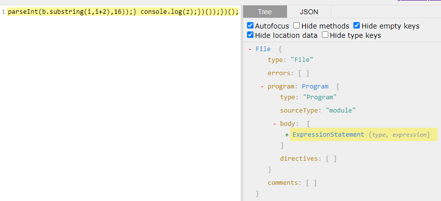

> ## Foreword:
  - ### Make sure you have [NodeJS](https://nodejs.org/en/) installed, a text editor or IDE (in my case I use [VSCode](https://code.visualstudio.com/)) and most preferably [Chrome](https://www.google.com/chrome/) as a browser (or any other Chromium based browser), but [Firefox](https://www.mozilla.org/en-US/firefox/new/) would suffice as well
  - ### From now on, the whole project will be hosted at [antibot-incapsula](https://github.com/nerodesu017/antibot-incapsula)
  - ### Tools used:
    - ### [ASTExplorer](https://astexplorer.net/)
    - ### [Google](https://google.com)
  - ### Incapsula is obfuscated using [Obfuscator.io](https://obfuscator.io/), while learning I haven't used this and tried to do it all by myself which in my opinion was fun and made me use my brain more, though I strongly encourage its use in case you get stuck and need help or just want to see more obfuscations that it can do -> [Obfuscator.io on Github](https://github.com/javascript-obfuscator/javascript-obfuscator)

#### I’ve dug a little bit the web and found a website that uses Incapsula (will put the script I got up on github, since it changes values every time and they have checks in their backend, the script I provide will suffice for our case)
#### The script looks something like this:


(function () {
  var z = "";
  var b = "766172205[...LONG BORING STRING...]7d7d2829293b";
  eval((function () {
    for (var i = 0; i < b.length; i += 2) {
      z += String.fromCharCode(parseInt(b.substring(i, i + 2), 16));
    }
    return z;
  })());
})();


#### Let’s plug this big blob in [ASTExplorer](https://astexplorer.net/) and see what kind of nodes is the our Program composed of!

#### Plugging the script in [ASTExplorer](https://astexplorer.net/) tells us there’s a single node! So, if you’ve spent a bit of time in the coding world you’ll realize that this node is an IIFE (Immediately Invoked Function Expression), it is a function that has no name (just like a lambda) and gets executed the moment the interpreter gets to it.

#### Getting back to the script, and looking at the instructions following the definition of the boring long script, we see there's an eval that evaluates the string that gets put into the 'z' variable

#### So the function that's passed as an argument to the eval is kind of like a decoding function, transforms the b string into actual code that gets put into the z variable, which then gets executed (the eval function only executes the return/or the last value of the argument it gets passed)

#### What we can do is, instead of returning z, we can modify that line to log the script to the console, so it ends up being like this:


(function () {
  var z = "";
  var b = "766172205[...LONG BORING STRING...]7d7d2829293b";
  eval((function () {
    for (var i = 0; i < b.length; i += 2) {
      z += String.fromCharCode(parseInt(b.substring(i, i + 2), 16));
    }
    console.log(z);
  })());
})();


#### Since there are no checks inside the first script, you can just execute the script and pipe the output into a file like this:


node incapsula.js > incapsula_unpacked.js
