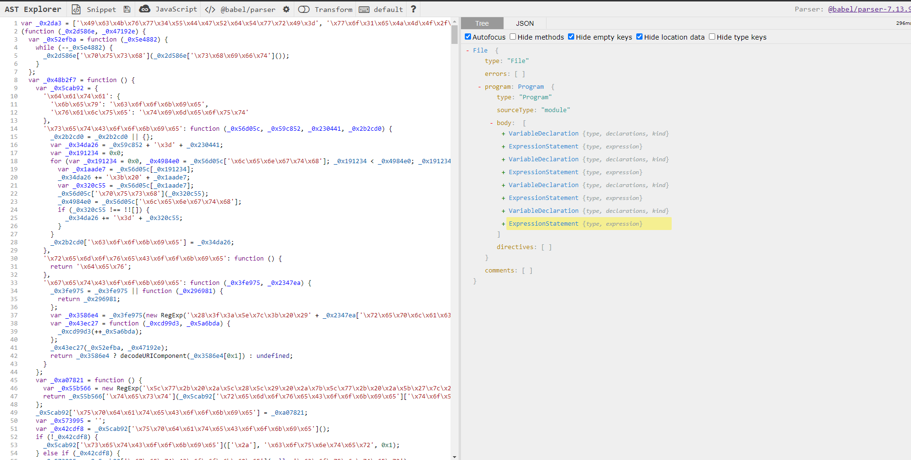
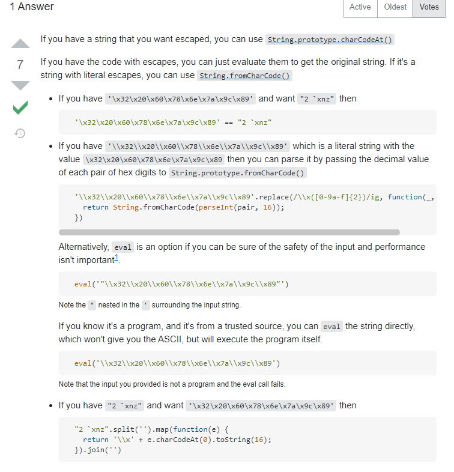
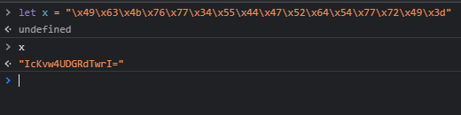
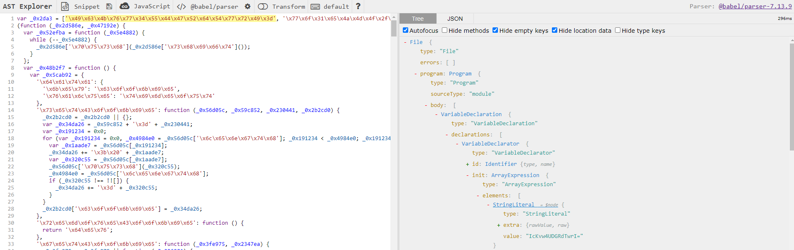
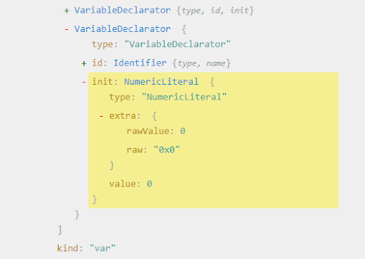
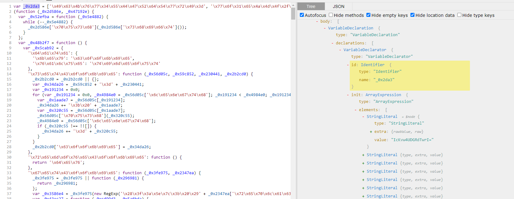

#### We've got over the first part! After beautifying the file, it looks something like this:


var _0x2da3 = ['\x49\x63\x4b\x76\x77\x34\x55\x44\x47\x52\x64\x54\x77\x72\x49\x3d', '\x77\x6f\x31\x65\x4a\x4d\x4f\x2f\x45\x51\x6e\x43\x70\x51\x58\x44\x6f\x6b\x64\x71\x54\x73\x4b\x76\x77\x34\x33\x44\x6f\x57\x6e\x44\x6a\x6a\x30\x4f', '\x77\x72\x42\x45\x56\x38\x4b\x6b\x77\x34\x38\x3d', ..., '\x49\x4d\x4b\x5a\x77\x35\x66\x44\x70\x4d\x4f\x33'];
(function (_0x2d586e, _0x47192e) {
  var _0x52efba = function (_0x5e4882) {
    while (--_0x5e4882) {
      _0x2d586e['\x70\x75\x73\x68'](_0x2d586e['\x73\x68\x69\x66\x74']());
    }
  };
  var _0x48b2f7 = function () {
    var _0x5cab92 = {
      '\x64\x61\x74\x61': {
        '\x6b\x65\x79': '\x63\x6f\x6f\x6b\x69\x65',
        '\x76\x61\x6c\x75\x65': '\x74\x69\x6d\x65\x6f\x75\x74'
      },
      '\x73\x65\x74\x43\x6f\x6f\x6b\x69\x65': function (_0x56d05c, _0x59c852, _0x230441, _0x2b2cd0) {
        _0x2b2cd0 = _0x2b2cd0 || {};
        var _0x34da26 = _0x59c852 + '\x3d' + _0x230441;
        var _0x191234 = 0x0;
        for (var _0x191234 = 0x0, _0x4984e0 = _0x56d05c['\x6c\x65\x6e\x67\x74\x68']; _0x191234 < _0x4984e0; _0x191234++) {
          var _0x1aade7 = _0x56d05c[_0x191234];
          _0x34da26 += '\x3b\x20' + _0x1aade7;
          var _0x320c55 = _0x56d05c[_0x1aade7];
          _0x56d05c['\x70\x75\x73\x68'](_0x320c55);
          _0x4984e0 = _0x56d05c['\x6c\x65\x6e\x67\x74\x68'];
          if (_0x320c55 !== !![]) {
            _0x34da26 += '\x3d' + _0x320c55;
          }
        }
        _0x2b2cd0['\x63\x6f\x6f\x6b\x69\x65'] = _0x34da26;
      },
      '\x72\x65\x6d\x6f\x76\x65\x43\x6f\x6f\x6b\x69\x65': function () {
        return '\x64\x65\x76';
      },
      ...


#### Kind of really ugly, ugly variable names, ugly String literals and scrolling down a little bit we can also see ugly Numeric literals!
 


var _0x32da = function (_0x56d61d, _0x38c237) {
  _0x56d61d = _0x56d61d - 0x0;
  var _0x120e45 = _0x2da3[_0x56d61d];
  if (_0x32da['\x69\x6e\x69\x74\x69\x61\x6c\x69\x7a\x65\x64'] === undefined) {
    (function () {
      var _0x593185 = Function('\x72\x65\x74\x75\x72\x6e\x20\x28\x66\x75\x6e\x63\x74\x69\x6f\x6e\x20\x28\x29\x20' + '\x7b\x7d\x2e\x63\x6f\x6e\x73\x74\x72\x75\x63\x74\x6f\x72\x28\x22\x72\x65\x74\x75\x72\x6e\x20\x74\x68\x69\x73\x22\x29\x28\x29' + '\x29\x3b');
      var _0x460c0e = _0x593185();
      var _0x5ac972 = '\x41\x42\x43\x44\x45\x46\x47\x48\x49\x4a\x4b\x4c\x4d\x4e\x4f\x50\x51\x52\x53\x54\x55\x56\x57\x58\x59\x5a\x61\x62\x63\x64\x65\x66\x67\x68\x69\x6a\x6b\x6c\x6d\x6e\x6f\x70\x71\x72\x73\x74\x75\x76\x77\x78\x79\x7a\x30\x31\x32\x33\x34\x35\x36\x37\x38\x39\x2b\x2f\x3d';
      _0x460c0e['\x61\x74\x6f\x62'] || (_0x460c0e['\x61\x74\x6f\x62'] = function (_0x4ecd57) {
        var _0x295218 = String(_0x4ecd57)['\x72\x65\x70\x6c\x61\x63\x65'](/=+$/, '');
        for (var _0x326ce3 = 0x0 /* Here is our numeric literal!!! */, _0x5957e8, _0x3831ca, _0x57ba04 = 0x0, _0x10d9ea = ''; _0x3831ca = _0x295218['\x63\x68\x61\x72\x41\x74'](_0x57ba04++); ~_0x3831ca && (_0x5957e8 = _0x326ce3 % 0x4 ? _0x5957e8 * 0x40 + _0x3831ca : _0x3831ca, _0x326ce3++ % 0x4) ? _0x10d9ea += String['\x66\x72\x6f\x6d\x43\x68\x61\x72\x43\x6f\x64\x65'](0xff & _0x5957e8 >> (-0x2 * _0x326ce3 & 0x6)) : 0x0) {
          _0x3831ca = _0x5ac972['\x69\x6e\x64\x65\x78\x4f\x66'](_0x3831ca);
        }
        return _0x10d9ea;
      });
    }());
    var _0x2631d3 = function (_0x52a6b2, _0x48a483) {
      var _0x43db9b = [],
        _0x35705d = 0x0,
        _0x3d4281, _0xd40cce = '',
        _0x11a5a5 = '';
      _0x52a6b2 = atob(_0x52a6b2);
      ...


#### Aight, once again, let's go for [ASTExplorer](https://astexplorer.net/)

#### Hmm, so this whole script is made of a few variable declarations and also expression statements (P.S. they are IIFE’s just like we’ve met before)

#### We’d want, if possible, to do something about those ugly StringLiterals. We can see they have something in common, they are full of the prefix “\x” so let’s try searching the web and see if there’s anything we can find about this.

#### Haha, bingo! The first google link is a [stackoverflow link](https://stackoverflow.com/questions/34056509/javascript-x-escaping)

#### The first (and only) answer speaks about Hex String Literals, interesting.. The answer talks only about escaped hex characters and how to transform them, what can we do in our case? Let’s try doing this in the browser’s sandbox (at the moment, you can do the same using NodeJS as a sandbox, it’s not much different, I’ll tell you when the work gets messy)

#### Taking the first string from the array, we can see that after declaring it and when we try to print it, the value that gets printed is the escaped one already, great news!!! So this means that the hex strings get saved as ascii ones after declaration!

#### Let’s jump into [ASTExplorer](https://astexplorer.net/) and check the StringLiteral node:

#### After expanding parent nodes, we get to where we want to, our StringLiteral! It has a few properties, let’s take a deeper look. We got its actual value, and rawValue and raw (raw refers to the raw raw, I assume, not even I am entirely sure, the raw raw value unescaped?!?!?)

#### Here’s the part where we get our hands dirty and actually start writing some deobfuscation in javascript! Let’s go!

#### First, make sure you have the babel suite we’ll use installed:


npm i babel @babel/types @babel/parser @babel/traverse @babel/generator


#### P.S. You can skip this, get the package-lock.json or package.json file from the [Project's Github Repo](https://github.com/nerodesu017/antibot-incapsula)

#### After that, we are ready to start! I've already created a template file where you can get started without dealing with the input and output functions, you can find it on the [Project's Github Repo](https://github.com/nerodesu017/antibot-incapsula)

#### template.js

const fs = require('fs');
const types = require('@babel/types');
const parser = require('@babel/parser');
const traverse = require('@babel/traverse').default;
const generate = require('@babel/generator').default;

let testing_opts = {
  comments: false,
  minified: true,
  concise: true,
}

let beautify_opts = {
  comments: true,
  minified: false,
  concise: false,
}

const script = fs.readFileSync('incapsula_unpacked.js', 'utf-8');

const AST = parser.parse(script, {})

// YOUR VISITORS HERE

const myVisitor = {

}

traverse(AST, myVisitor);

// YOUR VISITORS HERE

const final_code = generate(AST, beautify_opts).code;

fs.writeFileSync('incapsula_final.js', final_code);


#### In this tutorial we won't care much about this file, the only thing we need to care about at the moment is the part of the code between the "// YOUR VISITORS HERE" comments, that's where we'll write all our visitors and traverse and modify the AST with them. The final script will be in the "incapsula_final.js" file

#### Let's jump right in and create our first visitor! It will seek out all hex StringLiterals and NumericLiterals and transform them to ascii values!


// YOUR VISITORS HERE

const hexToAsciiVisitor = {
  StringLiteral(path){
    delete path.node.extra.raw;
  },
  NumericLiteral(path){
    delete path.node.extra.raw;
  }
}

traverse(AST, hexToAsciiVisitor);

// YOUR VISITORS HERE


#### Now, let me explain: First, we create an object which will be our visitor (in our case "hexToAsciiVisitor"). Then, we proceed to only care about nodes of types StringLiteral and NumericLiteral that our visitor visits (All types that we wish to seek for must be made as methods for our visitor). Lastly, we make sure we pass them a "path" argument, path is kind of the main parent where our node resides, in the upcoming tutorials I'll explain more in detail the path object which babel defines, it's a little more complex than others' traversers (shift-ast for example), but it is really powerful!

#### Let's look at my process of thought when building this visitor

#### This is what a Literal looks specifically as a node made by babel. It seems as the problem we have here is the "raw" property of the "extra" property of our main node we arrived at! So by just deleting it, when the generator creates the final script from the AST, it no longer finds the "raw" property so now relies on the "rawValue" property which is what we want! Success!

#### Let's take a look at the output!


var _0x2da3 = ["IcKvw4UDGRdTwrI=", "wo1eJMO/EQnCpQXDokdqTsKvw43DoWnDjj0O", ..., "IMKZw5fDpMO3"];

(function (_0x2d586e, _0x47192e) {
  var _0x52efba = function (_0x5e4882) {
    while (--_0x5e4882) {
      _0x2d586e["push"](_0x2d586e["shift"]());
    }
  };

  var _0x48b2f7 = function () {
    var _0x5cab92 = {
      "data": {
        "key": "cookie",
        "value": "timeout"
      },
      "setCookie": function (_0x56d05c, _0x59c852, _0x230441, _0x2b2cd0) {
        _0x2b2cd0 = _0x2b2cd0 || {};

        var _0x34da26 = _0x59c852 + "=" + _0x230441;

        var _0x191234 = 0;

        for (var _0x191234 = 0, _0x4984e0 = _0x56d05c["length"]; _0x191234 < _0x4984e0; _0x191234++) {
          var _0x1aade7 = _0x56d05c[_0x191234];
          _0x34da26 += "; " + _0x1aade7;
          var _0x320c55 = _0x56d05c[_0x1aade7];

          _0x56d05c["push"](_0x320c55);

          _0x4984e0 = _0x56d05c["length"];
  ...


#### Much better!

#### Now, you have to keep in mind, sometimes, these Literals, more specifically, StringLiterals, contain Unicode characters. Unicode characters are represented by something like this '\u0123' - with the '\u' prefix and then 4 digits, some of these are not printable, so saving it to a file especially under something like Windows might cause unexpected issues or our end result of the script to change, so keep in mind to find a better solution in the future! Lucky for us, even though Incapsula contains unicode characters in the StringLiterals, they are printable!

#### For the final part of this article, there's still an annoying problem. Maybe the computer doesn’t think this is a problem, but I don’t think we’re that ok as humans with those ugly variable names. Here’s where the renaming method comes into play! We can go through the script and rename each variable with a new name given by us!

#### Going back to the [Project's Github Repo](https://github.com/nerodesu017/antibot-incapsula), there's a folder called "names" and also a js file named "names.js" that I created (and that has around 500 variable names, a few more than Incapsula, so we make sure we have plenty to replace with) and that will help you with the renaming! All you need to do is import it in your main script like this:


const names = require('./names.js');


#### After that, let’s get on to writing our visitor! Remember about our last visitor and how we’ve accessed each node? We had to use “path.node” because the path also contains another property called “scope”. The "scope", in turn, contains all the references to that variable! Besides, the “scope” property has a method called “rename” which we can use to rename each variable name individually! Let’s get back a little to the [ASTExplorer](https://astexplorer.net/) and check for our variable/argument names.

#### What we can see is that each variable name, argument name, anything that points to a place where data is stored, the AST defines that as an “Identifier”, so let’s use that as the type of node we want to search for!


const names = require('./names.js');

const renameVisitor = {
  Identifier(path){
    if(path.node.name.startsWith('_0x')){
      path.scope.rename(path.node.name, names.shift());
    }
  }
}

traverse(AST, renameVisitor);


#### After we get to a node that is of "Identifier" type, we check to see if it starts with '_0x', which is what the obfuscated Identifiers have as prefix. Then, if the Identifier we are at is, indeed, obfuscated, we rename it.


var aardvark = ["IcKvw4UDGRdTwrI=", "wo1eJMO/EQnCpQXDokdqTsKvw43DoWnDjj0O", ..., "IMKZw5fDpMO3"];

(function (calf, cub) {
  var addax = function (agouti) {
    while (--agouti) {
      calf["push"](calf["shift"]());
    }
  };

  var pup = function () {
    var alligator = {
      "data": {
        "key": "cookie",
        "value": "timeout"
      },
      "setCookie": function (hatchling, alpaca, cria, anteater) {
        anteater = anteater || {};
        var antelope = alpaca + "=" + cria;
        var ant = 0;

        for (var ant = 0, antling = hatchling["length"]; ant < antling; ant++) {
          var ape = hatchling[ant];
          antelope += "; " + ape;
          var baby = hatchling[ape];
          hatchling["push"](baby);
          antling = hatchling["length"];

          if (baby !== !![]) {
            antelope += "=" + baby;
          }
        }
        ...


#### Run the script, and voila! This looks much better now, or at least easier for us to understand!