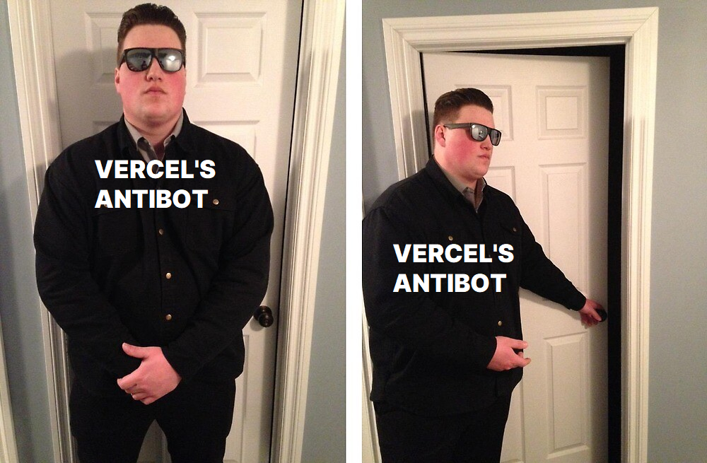
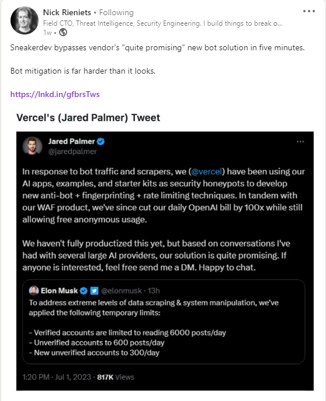
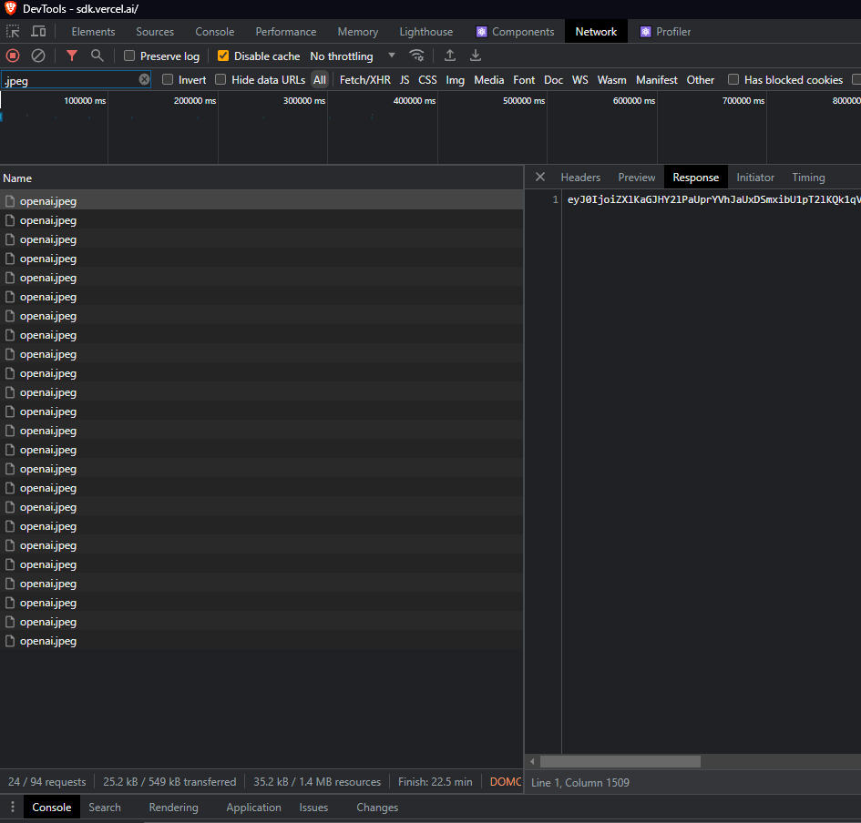
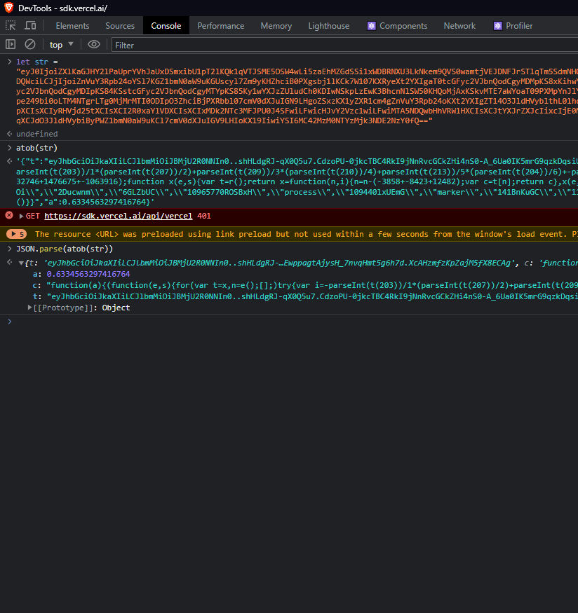
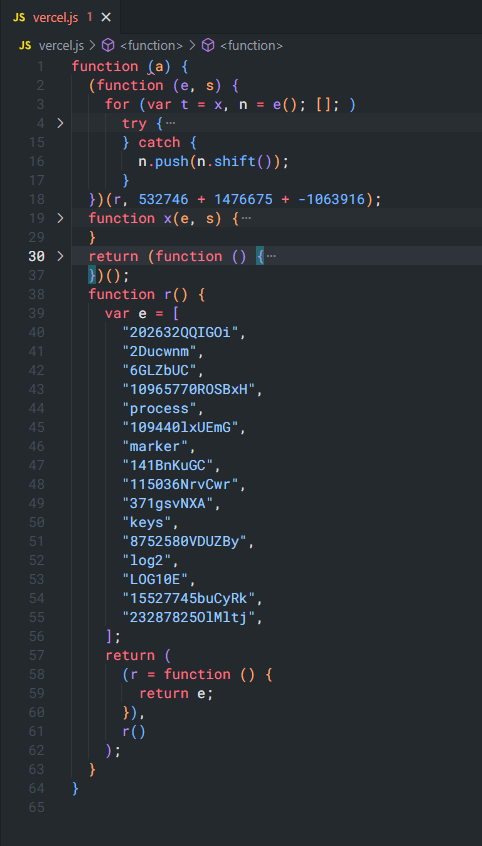
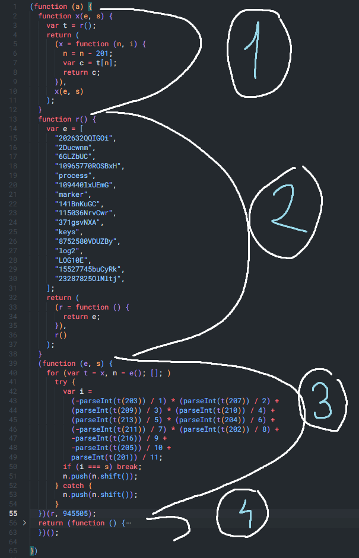

Just for the record, we are not CRACKING Vercel's antibot, we are merely taking a look at it. I do NOT condone using the materials presented by me for any illegal/against-the-TOS activities, I am not responsible for what YOU do with this information. 

And yeah, the title might be a little clickbait, but HOLD ON, we are taking a good look at Vercel's antibot (if it can be named an antibot, the person who wrote it most probably just prompted ChatGPT for a random antibot written by a 10yo).

## How did we get here?
I was glaring through LinkedIn when a post made by Nick Rieniets caught my attention (also S/O [aarock1234](https://github.com/aarock1234)):

Here, we can see Vercel's Chief Meme Officer (Jared Palmer) telling his Twitter followers how they cut down on their ChatGPT bill by implementing an antibot. Nick is taking some shots at their antibot, making fun of the "quite promising" part. But is Nick in the right? Is Vercel's antibot really that bad? Is a company with a Valuation of over 2.5 BILLION DOLLARS using poorly-made tools? Let's take a look!

## Getting our hands dirty
To first play with it, we need it to find it. Cool thing is, we already know it, it's there, in the tweet. ChatGPT bill, so they have an AI app on the web somewhere. A little digging and we get to: [SDK.VERCEL.AI](https://sdk.vercel.ai/)

Open up Inspect Element, go over to the Network tab, AND WHAT DO WE FIND?

We find some kind of script/payload hidden inside a .jpeg. Now, if you've been on the web as a dev for quite a while now, you'd probably recognize this kind of script/payload, the format, it's hardly unknown to you:

It's literally a base64 encoded JSON payload. Literally just that.

Let's paste it inside VSCode see what we can make of it, bare hands and brain, no Tool-Assisted Speedrun here:

2.5 BILLION Dollars in just 65 lines of code. Shut up and take my money. Kowalski, Analysis.

As we can see, it throws an error. Searching for `openai.jpeg` on that page, leads us to:


async()=>{
    let response = await fetch("/openai.jpeg")
      , data = JSON.parse(atob(await response.text()))
      , ret = eval("(".concat(data.c, ")(data.a)"));
    return btoa(JSON.stringify({
        r: ret,
        t: data.t
    }))
}


So, we can easily solve the error by wrapping the anonymous function inside parantheses and also making it an IIFE by providing the argument that it needs: `data.a`. This argument is, in our case, 0.6334563297416764. We also organize the code so we read it exactly like V8 would 
Then, we'd have:

Here, we got 4 main instructions inside the IIFE:
1. The `x` function. As we can see, this function has 2 parameters: `e`, `s`. From my experience and what I can read here, the `e` parameter is a placeholder for a Number, and `s` should be a String Array, but, if we take a close look, it is not REALLY referenced anywhere. Instead, we have the VariableDeclaration: `var t = r()`, which makes `t` be the String Array we are looking for. SUMMARY: the `x` function returns a String from a String Array.
2. The `r` function. This is the function that holds the String Array and returns it when called. This is the same one referenced by the `x` function.
3. The IIFE that has 2 params: `e` and `s`. Here, it is not hard to see that this IIFE uses the Array Methods: `push` and `shift`. This is for shifting elements inside the String Array.
4. The return statement that is yet another IIFE which returns an array with 3 elements.

Manually executing the first 3 instructions, when we run the `r` function, we get:



r() = ['23287825OlMltj', '202632QQIGOi', '2Ducwnm', '6GLZbUC', '10965770ROSBxH', 'process', '109440lxUEmG', 'marker', '141BnKuGC', '115036NrvCwr', '371gsvNXA', 'keys', '8752580VDUZBy', 'log2', 'LOG10E', '15527745buCyRk'];



Now, playing with the contents of the returned IIFE, from:



return (function () {
    var e = x;
    return [
      a / Math[e(214)](a % Math[e(215)]),
      Object[e(212)](globalThis[e(206)] || {}),
      globalThis[e(208)],
    ];
  })();



We get to:



return (function () {
    return [
      a / Math["log2"](a % Math["LOG10E"]),
      Object["keys"](globalThis["process"] || {}),
      globalThis["marker"],
    ];
  })();



Which, after we beautify it a bit, boils down to:



return (function () {
    return [
      a / Math.log2(a % Math.LOG10E),
      Object.keys(globalThis.process || {}),
      globalThis.marker,
    ];
  })();



Rewriting the full IIFE gets us to:



(function (a) {
  return (function () {
    return [
      a / Math.log2(a % Math.LOG10E),
      Object.keys(globalThis.process || {}),
      globalThis.marker,
    ];
  })();
})(0.6334563297416764)



By actually placing a breakpoint in the vercel's script on the page we went to (the sdk.vercel.ai) and seeing what the result should look like, we get:



[-0.2721047785873762, Array(0), "mark"]



And that, Ladies and Gentlemen, is Vercel's Antibot. I'll let you decide if it's top-notch or not. 
I won't get into how to integrate it to make requests automatically to spam their API, as I do NOT condone that.

## What did we learn?
Well, first of all, that people are usually lazy. Why do I say that? If this antibot ALONE made them cut their daily OpenAI bill by 100x, it means people are REALLY lazy. I'm not saying it's that easy to understand all of this, it took me a ton of time when I started out, but this particular antibot is not hard at all.

Second of all, as Jared outlined in his [tweet](https://twitter.com/jaredpalmer/status/1675192755763412992), you need more than just an antibot:
  - Rate limit against IP and User IDs
  - Block traffic from bad acting nation states
  - Only allow requests from __REAL__ browsers (ok, this is antibot related)

For the second point, I'd like to say, that you need to have a basic system (at the very least) in place that covers the next bases:
  1. Authentication
  2. Authorization
  3. Rate Limiting
  4. Logging
  5. Encryption

Neil Madden talks about these more in detail in his book: [API Security in Action](https://amzn.to/3Oekc0u), which I strongly recommend. For someone starting out and not wanting to code all of these and get really deep into them, you can use Cloudflare, it offers logging for routes, free SSL certs in a few clicks, but for others, you'll need to do it yourself.

See you next time!